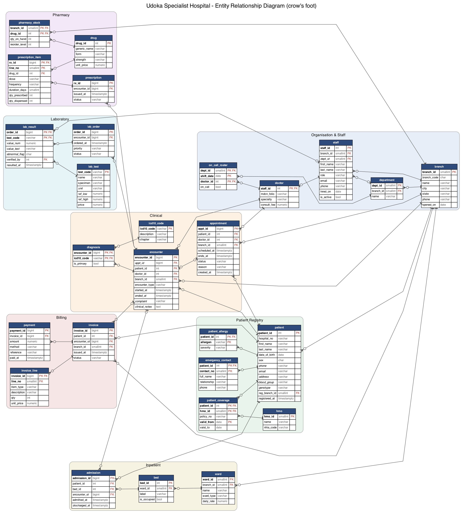

# Portfolio 1 – Database Design and Modelling

**Case study:** Udoka Specialist Hospital (a simulated organisation) · **DBMS:** PostgreSQL 16.15

## 1. The organisation

Udoka Specialist Hospital is a fictional private hospital group in South-East Nigeria. It has a
120-bed main hospital in **Enugu** and two outpatient clinics with small observation and maternity
wards, in **Nsukka** (opened 2016) and **Awka** (opened 2019). The group is replacing paper folders
and spreadsheets with one shared patient database, so a patient registered in one branch can be
treated in any branch.

| Item | Description |
|---|---|
| Nature of business | Outpatient consultations, 24-hour emergency care (Enugu only), inpatient admissions, laboratory, pharmacy and billing, including HMO/NHIA-insured patients |
| Database users | Records officers (registration, appointments), doctors (consultation, diagnosis, prescribing, lab requests), nurses (admissions, bed management), lab scientists (results), pharmacists (dispensing, stock), billing officers (invoices, payments), management (reports), patients (future portal) |
| Major data stored | Patients and their allergies, emergency contacts and HMO cover; staff and doctors; appointments; clinical encounters with ICD-10 diagnoses; prescriptions; lab orders and results; wards, beds and admissions; invoices and payments; an audit trail of changes to clinical records |
| Key operations | Register patient · book or cancel appointment without double-booking a doctor · record consultation and diagnosis · prescribe and dispense drugs without negative stock · order and verify lab tests · admit, transfer and discharge patients · raise invoices and post payments · retrieve full patient history · management reporting (revenue, disease trends, bed occupancy) |

## 2. Entity–Relationship model



The diagram is generated from the live database catalog by
[`diagrams/generate_er.py`](diagrams/generate_er.py), so it always matches the SQL. A `tee` end means
"exactly one", a circle means "optional", and a crow's foot means "many". Italic columns are nullable,
**bold** columns form the primary key.

Main relationships and the business rules behind them:

| Relationship | Cardinality | Rule |
|---|---|---|
| branch – department – staff | 1:N, 1:N | Each department belongs to one branch; staff are attached to one home branch |
| staff – doctor | 1:0..1 (IS-A) | A doctor is a staff member with extra attributes (MDCN folio, specialty, fee). Implemented as a *shared primary key* subtype |
| patient – appointment – doctor | M:N resolved by appointment | A patient sees many doctors over time; the appointment is the associative entity |
| appointment – encounter | 1:0..1 | A completed appointment produces one encounter; walk-in and emergency encounters have no appointment (nullable FK + UNIQUE) |
| encounter – icd10_code | M:N via diagnosis | One encounter can carry several diagnoses, exactly one of them primary |
| encounter – prescription – drug | 1:N, M:N via prescription_item | |
| encounter – lab_order – lab_test | 1:N, M:N via lab_result | |
| ward – bed – admission – patient | 1:N, 1:N, N:1 | A bed has many admissions over time but never two that overlap |
| encounter – invoice – invoice_line / payment | 1:0..1, 1:N, 1:N | Partial payments are allowed |
| patient – hmo | M:N via patient_coverage | Coverage is time-bounded (valid_from / valid_to) |

## 3. Relational schema

Notation: **PK** underlined in the SQL, `FK → table`. The full DDL is in [`sql/01_schema.sql`](sql/01_schema.sql).

```
BRANCH(branch_id PK, branch_code UQ, name, city, state, phone, opened_on)
DEPARTMENT(dept_id PK, branch_id FK→BRANCH, name)                      UQ(branch_id, name)
STAFF(staff_id PK, branch_id FK→BRANCH, dept_id FK→DEPARTMENT, first_name, last_name, role, email UQ, phone, hired_on, is_active)
DOCTOR(staff_id PK FK→STAFF, mdcn_folio UQ, specialty, consult_fee)
ON_CALL_ROSTER(dept_id FK, shift_date, doctor_id FK→DOCTOR, on_call)   PK(dept_id, shift_date, doctor_id)
HMO(hmo_id PK, name UQ, nhia_code UQ)
PATIENT(patient_id PK, hospital_no UQ, first_name, last_name, date_of_birth, sex, phone, email, address,
        blood_group, genotype, reg_branch_id FK→BRANCH, registered_at)
PATIENT_ALLERGY(patient_id FK, allergen, severity)                     PK(patient_id, allergen)
EMERGENCY_CONTACT(patient_id FK, contact_no, full_name, relationship, phone)  PK(patient_id, contact_no)
PATIENT_COVERAGE(patient_id FK, hmo_id FK, policy_no, valid_from, valid_to)    PK(patient_id, hmo_id, valid_from)
APPOINTMENT(appt_id PK, patient_id FK, doctor_id FK, branch_id FK, scheduled_at, ends_at, status, reason, created_at)
ENCOUNTER(encounter_id PK, appt_id FK UQ NULL, patient_id FK, doctor_id FK, branch_id FK, encounter_type,
          started_at, ended_at, complaint, clinical_notes)
ICD10_CODE(icd10_code PK, description, chapter)
DIAGNOSIS(encounter_id FK, icd10_code FK, is_primary)                  PK(encounter_id, icd10_code)
DRUG(drug_id PK, generic_name, form, strength, unit_price)             UQ(generic_name, form, strength)
PHARMACY_STOCK(branch_id FK, drug_id FK, qty_on_hand, reorder_level)   PK(branch_id, drug_id)
PRESCRIPTION(rx_id PK, encounter_id FK, issued_at, status)
PRESCRIPTION_ITEM(rx_id FK, line_no, drug_id FK, dose, frequency, duration_days, qty_prescribed, qty_dispensed)  PK(rx_id, line_no)
LAB_TEST(test_code PK, name, specimen, unit, ref_low, ref_high, price)
LAB_ORDER(order_id PK, encounter_id FK, ordered_at, priority, status)
LAB_RESULT(order_id FK, test_code FK, value_num, value_text, abnormal_flag, verified_by FK→STAFF, resulted_at)  PK(order_id, test_code)
WARD(ward_id PK, branch_id FK, name, ward_type, daily_rate)            UQ(branch_id, name)
BED(bed_id PK, ward_id FK, label, is_occupied)                         UQ(ward_id, label)
ADMISSION(admission_id PK, patient_id FK, bed_id FK, encounter_id FK NULL, admitted_at, discharged_at)
INVOICE(invoice_id PK, patient_id FK, encounter_id FK NULL, branch_id FK, issued_at, status)
INVOICE_LINE(invoice_id FK, line_no, item_type, description, qty, unit_price)  PK(invoice_id, line_no)
PAYMENT(payment_id PK, invoice_id FK, amount, method, reference UQ, paid_at)
AUDIT_LOG(audit_id PK, table_name, operation, row_pk, changed_by, changed_at, old_row jsonb, new_row jsonb)
```

## 4. Keys and constraints

The schema declares **28 primary keys, 39 foreign keys, 12 unique constraints, 35 CHECK constraints
and 2 exclusion constraints**, plus 2 partial unique indexes and an audit trigger.

**Key choices**

- **Surrogate keys** (`GENERATED ALWAYS AS IDENTITY`) for high-volume transactional tables, so that keys
  never change and joins stay narrow. The real-world identifier is still enforced as an **alternate key**,
  e.g. `patient.hospital_no` (USH-0001234), `doctor.mdcn_folio` and `payment.reference`.
- **Natural keys** where the code is stable and meaningful: `icd10_code`, `lab_test.test_code`.
- **Composite keys** for weak and associative entities: `prescription_item(rx_id, line_no)`,
  `diagnosis(encounter_id, icd10_code)`, `pharmacy_stock(branch_id, drug_id)`.
- `payment.reference` is UNIQUE so that a POS terminal or bank webhook that retries cannot post the same
  payment twice. The database itself enforces idempotency.

**Business rules enforced in the database (not only in the application)**

| Rule | Mechanism |
|---|---|
| A doctor cannot be double-booked | `EXCLUDE USING gist (doctor_id WITH =, tstzrange(scheduled_at, ends_at) WITH &&) WHERE status is live`. A cancelled slot frees up automatically |
| A bed cannot hold two overlapping stays | Exclusion constraint on `tstzrange(admitted_at, COALESCE(discharged_at,'infinity'))` |
| A patient has at most one open admission | Partial unique index `WHERE discharged_at IS NULL` |
| Exactly one primary diagnosis per encounter | Partial unique index `WHERE is_primary` |
| Stock can never be negative; cannot dispense more than prescribed | `CHECK (qty_on_hand >= 0)`, `CHECK (qty_dispensed BETWEEN 0 AND qty_prescribed)` |
| Valid clinical codes | CHECK lists for sex, blood group, genotype (AA/AS/AC/SS/SC), statuses, roles |
| Clinical history cannot be lost | FK with default `NO ACTION` stops deleting a patient who has encounters; child detail rows (items, results) use `ON DELETE CASCADE` |
| Accountability (NDPA 2023) | `AFTER` row trigger writes before/after JSONB images of changes to encounters, diagnoses, prescriptions and lab results into `audit_log` |

**Design lesson:** my first version enforced double-booking with
`tstzrange(scheduled_at, scheduled_at + duration)`. PostgreSQL rejected it
(`functions in index expression must be marked IMMUTABLE`): adding an interval to a `timestamptz`
depends on the session time zone, so it is only STABLE. I replaced `duration_min` with a stored
`ends_at` column plus a CHECK on the length.

**Evidence:** [`sql/04_constraint_tests.sql`](sql/04_constraint_tests.sql) attacks each rule inside a
rolled-back transaction. The output is in [`evidence/constraint_tests_output.txt`](evidence/constraint_tests_output.txt)
and all 14 tests behave as expected. For example:

```
--- T4 (exclusion constraint): book a doctor into a slot that overlaps a live booking
ERROR:  conflicting key value violates exclusion constraint "no_doctor_double_booking"
DETAIL: Key (doctor_id, tstzrange(scheduled_at, ends_at))=(30, ["2026-11-02 08:05+01","2026-11-02 08:20+01"))
        conflicts with existing key (doctor_id, tstzrange(scheduled_at, ends_at))=(30, ["2026-11-02 08:00+01","2026-11-02 08:15+01")).
--- T13 (trigger): changing a diagnosis writes an audit_log row
 table_name | operation | row_pk | old_code | new_code
 diagnosis  | U         | 21     | B54      | B50.9
```

## 5. Normalisation

The starting point was the hospital's paper **"Patient Visit Sheet"**. One flat record per visit looked like this:

```
VISIT_SHEET(hospital_no, patient_name, dob, genotype, allergies{...}, branch_name, branch_city,
            visit_date, doctor_name, doctor_specialty, doctor_fee, diagnoses{code, description},
            drugs{drug_name, strength, unit_price, dose, qty}, tests{test, result, ref_range},
            amount_paid, total_bill)
```

**UNF → 1NF.** Remove repeating groups and multi-valued attributes. `allergies`, `diagnoses`, `drugs`
and `tests` become separate relations keyed by the visit (or patient) plus an item identifier, and
`patient_name` is split into atomic `first_name` / `last_name`.
→ `PATIENT_ALLERGY`, `DIAGNOSIS`, `PRESCRIPTION_ITEM`, `LAB_RESULT`.

**1NF → 2NF.** Remove partial dependencies on part of a composite key. In
`DIAGNOSIS(visit_id, icd10_code, description, is_primary)` we have
`icd10_code → description`, which depends on only part of the key, so it moves to `ICD10_CODE`.
In `PRESCRIPTION_ITEM(visit_id, drug_name, strength, unit_price, dose, qty)` we have
`drug → strength, unit_price`, so it moves to `DRUG`. Likewise `test → name, ref_low, ref_high, price` moves to `LAB_TEST`.

**2NF → 3NF.** Remove transitive dependencies.
- `visit → doctor_id → doctor_specialty, doctor_fee` gives `DOCTOR`.
- `visit → branch_code → branch_name, branch_city` gives `BRANCH`.
- `visit → hospital_no → patient_name, dob, genotype` gives `PATIENT`.
- `total_bill` and `balance` are derived (`Σ qty × unit_price − Σ payments`), so they are **not stored**.
  They come from the view `invoice_summary`. This removes the update anomaly where a corrected invoice
  line leaves a stale total.

**BCNF check.** Every non-trivial functional dependency in the final relations has a superkey on the
left. Each candidate key, such as `hospital_no`, `mdcn_folio` or `(branch_id, name)` in DEPARTMENT, is
either the PK or declared UNIQUE. So the determinants are all keys, and the schema is in BCNF.

**Deliberate, documented redundancy**

| Column | Why it is kept | How consistency is protected |
|---|---|---|
| `bed.is_occupied` | Derivable from `admission`, but the bed board is read constantly by nurses | Updated in the same transaction as admit/discharge (Portfolio 3). The exclusion constraint on `admission` remains the real guarantee |
| `encounter.branch_id`, `appointment.branch_id` | Doctors can work at more than one branch, so the branch where a visit happened is a fact of the visit, not of the doctor | n/a – not a true redundancy |
| `invoice.patient_id` | An invoice may exist without an encounter (e.g. pharmacy over-the-counter sale) | Set from the encounter when one exists |

## 6. Data set

[`sql/03_generate_data.sql`](sql/03_generate_data.sql) generates **about 4.8 million rows** of synthetic but
realistic activity for Jan 2023 – Nov 2026. It is fully deterministic (`setseed`), so anyone can reproduce
it. Realism rules built into the generator:

- Diagnoses depend on the doctor's specialty. Malaria and antenatal care dominate, as they would in a
  Nigerian hospital.
- Drugs and lab tests follow the diagnosis (e.g. malaria → artemether/lumefantrine + paracetamol; MP film + PCV).
- Long-registered patients visit more often (median 7 appointments per patient, max 62).
- Maternity beds go to women aged 20–48 and paediatric beds to children.
- HMO patients pay through their HMO.

| table | rows | | table | rows |
|---|---:|---|---|---:|
| invoice_line | 1.31 M | | lab_order | 158 k |
| prescription_item | 562 k | | emergency_contact | 78 k |
| diagnosis | 448 k | | patient_coverage | 63 k |
| appointment | 414 k | | patient | 60 k |
| lab_result | 378 k | | admission | 13 k |
| encounter / invoice | 357 k each | | staff | 290 (60 doctors) |

## 7. How to reproduce

```bash
brew install postgresql@16 && brew services start postgresql@16
export PATH=/opt/homebrew/opt/postgresql@16/bin:$PATH
./build_database.sh                                     # ~45 s: schema + reference data + 4.8 M rows
psql -X -e -d udoka_hms -f sql/04_constraint_tests.sql  # constraint tests
../.venv/bin/python diagrams/generate_er.py             # redraw ER diagram (needs graphviz)
```

| File | Purpose |
|---|---|
| `sql/01_schema.sql` | DDL: tables, keys, constraints, view, audit trigger function |
| `sql/02_reference_data.sql` | Branches, departments, wards/beds, HMOs, ICD-10 subset, drugs, lab tests |
| `sql/03_generate_data.sql` | Deterministic synthetic data generator + trigger attachment |
| `sql/04_constraint_tests.sql` | Negative tests proving the constraints work |
| `sql/05_row_counts.sql` | Table sizes |
| `diagrams/` | ER diagram (`.png`, `.svg`, `.dot`) and its generator |
| `evidence/` | Captured outputs |
