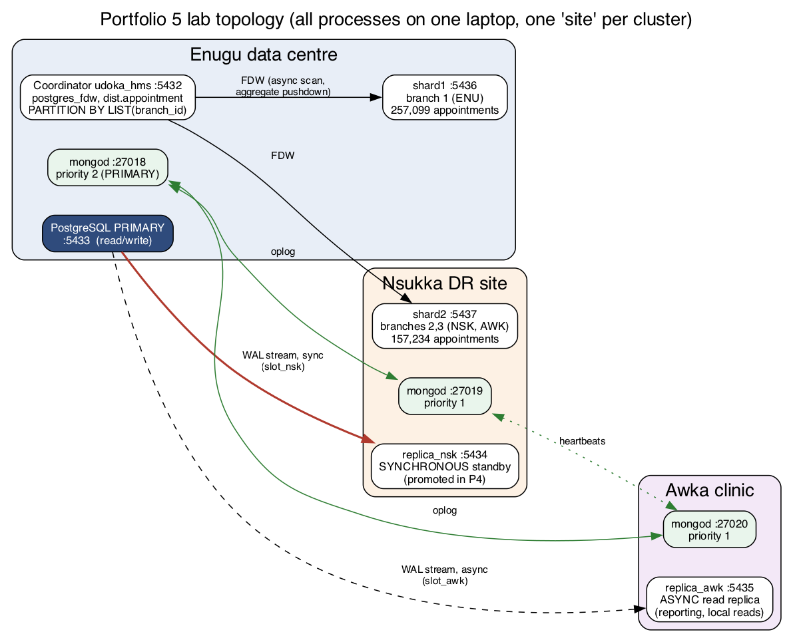
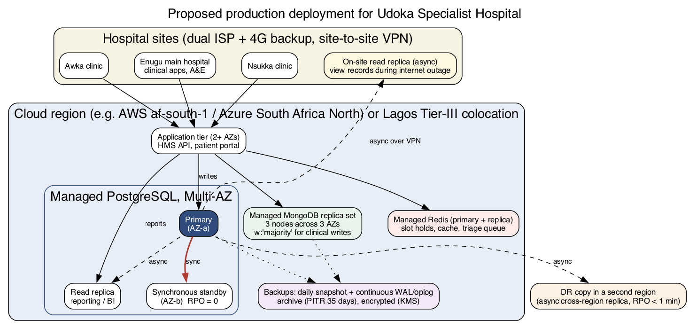

# Portfolio 5 – Distributed and Cloud Database Exercise

**Case study:** Udoka Specialist Hospital: main hospital in **Enugu**, clinics in **Nsukka** and **Awka**.
**Lab:** 5 PostgreSQL 16 servers + 3 MongoDB 9 members, all running on one laptop. Each server plays the
role of one site.

## 1. Requirements that drive the distributed design

| Requirement | Why the hospital needs it | Target |
|---|---|---|
| Survive the loss of the Enugu server room (power, flood, fire) | Clinical records must always be available | **RPO = 0** for clinical/billing data, **RTO < 5 min** |
| Clinics keep *reading* records when the WAN link drops | Internet outages are common at the satellite sites | Local read replica |
| Reporting must not slow down clinical work | Month-end reports overlap with clinic hours | Separate read replica |
| Room for growth (more clinics, years of history) | Appointment volume grows every year | Horizontal partitioning by branch |



## 2. Setup (deployment evidence)

| Script | What it builds | Evidence |
|---|---|---|
| [`scripts/01_setup_replication.sh`](scripts/01_setup_replication.sh) | `initdb` primary (:5433, `wal_level=replica`), loads the hospital DB with the Portfolio 1 build script, `pg_basebackup` two standbys with physical replication slots, then `synchronous_standby_names = 'FIRST 1 (replica_nsk)'` | [`evidence/01_setup_replication_output.txt`](evidence/01_setup_replication_output.txt) |
| [`scripts/02_setup_shards.sh`](scripts/02_setup_shards.sh) | Two shard servers (:5436, :5437) + `postgres_fdw` coordinator with `dist.appointment PARTITION BY LIST (branch_id)` whose partitions are foreign tables | output of [`sql/sharding_demo.sql`](sql/sharding_demo.sql) |
| [`scripts/03_setup_mongo_rs.sh`](scripts/03_setup_mongo_rs.sh) | MongoDB replica set `rs_udoka`: Enugu (priority 2), Nsukka, Awka | [`evidence/mongo_replica_set.txt`](evidence/mongo_replica_set.txt) |
| [`scripts/teardown.sh`](scripts/teardown.sh) | Stops and deletes the whole lab (`.lab/` is git-ignored) | |

Replication status straight after setup:

```
 application_name |   state   | sync_state |    write_lag    |   replay_lag
 replica_awk      | streaming | async      | 00:00:00.000058 | 00:00:00.000058
 replica_nsk      | streaming | sync       | 00:00:00.014004 | 00:00:00.014004
```

## 3. Replication, consistency and availability ([`replication_lab.py`](replication_lab.py))

| # | Experiment | Observation (transcripts in `evidence/replication_*.txt`) |
|---|---|---|
| P1 | Roles | Standbys answer `pg_is_in_recovery() = true`, hold the same 414,332 appointments, and reject writes: `ERROR 25006: cannot execute INSERT in a read-only transaction` |
| P2a | Read-your-writes, `synchronous_commit = on` | **49 of 50** bookings were visible on the sync standby immediately after COMMIT. `on` only waits until the standby has *flushed* the WAL to disk, not *replayed* it |
| P2b | `synchronous_commit = remote_apply` | **50 / 50** visible, at about 0.26 ms per booking. Use this when the app reads from the standby right after writing |
| P2c | Stale read on the async Awka replica (WAL replay paused) | New booking: `found = 0` on Awka while the primary reports `bytes_behind = 680`. After resume: `found = 1`. That is **eventual consistency** in practice |
| P3a | **Network partition**: Nsukka standby unreachable | A booking **blocks** (`wait_event = SyncRep`). After 3 s the wait is cancelled: `WARNING: canceling wait for synchronous replication … The transaction has already committed locally, but might not have been replicated to the standby`. PostgreSQL chooses consistency over availability (**CP**) |
| P3b | Per-transaction downgrade | `SET LOCAL synchronous_commit = local` commits in 4.4 ms. Acceptable for non-critical writes, e.g. audit of a page view |
| P3c | **Quorum commit** `ANY 1 (replica_nsk, replica_awk)` | Awka's acknowledgement is enough: commit in 3.3 ms while Nsukka is down. Availability restored *without* giving up "at least one other copy" |
| P4 | **Failover**: Enugu primary killed (`pg_ctl stop -m immediate`) | `pg_promote()` on Nsukka gives timeline 1 → **2**. All 5 probe rows and the last booking committed before the crash are present: **RPO = 0**. First write accepted 0.23 s after the crash (scripted; real RTO adds detection time). Awka re-pointed to the new primary and streaming again |

**Lessons I hit while building it**

1. My first setup script turned on `synchronous_standby_names` *before* the standbys existed. The
   initial load hung on `CREATE DATABASE` with `wait_event = SyncRep`. This is the same CP behaviour as
   P3, discovered by accident. Synchronous replication is now enabled after the standbys attach.
2. `pg_basebackup -R` writes `primary_conninfo` to `postgresql.auto.conf`, which overrides
   `postgresql.conf`. As a result my `application_name` was ignored, both standbys showed up as `walreceiver`,
   and **neither was synchronous**. The settings now go into `postgresql.auto.conf`.
3. The first build took about 10 minutes. The log showed `checkpoint complete … write=269.998 s`:
   `pg_basebackup` waits for a *spread* checkpoint by default. `--checkpoint=fast` brought the whole
   build down to **41 s**.
4. `pg_control_checkpoint()` still showed timeline 1 right after promotion, because the
   end-of-recovery checkpoint is asynchronous. The current WAL file name (`00000002…`) is the reliable source.

## 4. Sharding ([`sql/sharding_demo.sql`](sql/sharding_demo.sql) → [`evidence/sharding_output.txt`](evidence/sharding_output.txt))

**Shard key = `branch_id`** (list partitioning). Enugu → shard1, Nsukka + Awka → shard2.

| # | Experiment | Observation |
|---|---|---|
| D1 | Distribution | shard1: 257,099 rows (**62 %**); shard2: 82,860 + 74,374 (38 %). The skew follows the business: the main hospital is busiest |
| D2 | Query *with* the shard key (`branch_id = 2`) | **Partition pruning**: a single `Foreign Scan on appointment_east`, with the filter pushed down in `Remote SQL: … WHERE … AND ((branch_id = 2))` |
| D3 | Query *without* it (doctor's schedule) | **Scatter-gather**: `Append → Async Foreign Scan` on both shards |
| D4 | Count by branch and status for 2025 | Partition-wise aggregation pushed down: each shard runs `SELECT branch_id, status, count(*) … GROUP BY 1, 2`, and only 9 rows cross the network |
| D5 | Same count, local vs sharded | 20.6 ms local vs 30.1 ms sharded. On one laptop this measures **FDW overhead**, not scale-out |
| D6 | Routed writes | Rows land on `appointment_east` / `appointment_enu` by branch. IDs come from a coordinator sequence, because shard-local identities would collide |
| D7 | Double-booking a doctor on a shard | Rejected by the shard's local exclusion constraint. It still works because **a doctor belongs to one branch, so all their appointments live on one shard**, which is a key reason for choosing `branch_id` |
| D8 | `branch_id = 4` | `no partition of relation "appointment" found for row` |
| D9 | Move an appointment Enugu → Awka atomically | **Two-phase commit**: `DELETE` on shard1 and `INSERT` on shard2, each `PREPARE TRANSACTION 'move_appt_1'` (visible in `pg_prepared_xacts`), then `COMMIT PREPARED` on both |
| D10 | 2PC abort path | shard2 votes **no** (exclusion violation), so shard1 runs `ROLLBACK PREPARED`; 0 prepared transactions left |

**What sharding costs.** Foreign keys to `patient` and `doctor` cannot cross servers. Global
uniqueness needs a central sequence or UUIDs. Queries without the shard key fan out to every shard.
`postgres_fdw` does **not** use 2PC automatically for multi-shard writes, which is why D9 drives it
explicitly. A transaction coordinator that crashes between the two phases leaves *in-doubt* prepared
transactions that hold locks until resolved. An alternative key, `hash(patient_id)`, would balance
load evenly and keep each patient's history on one shard, but every branch dashboard would fan out to
all shards and the per-doctor exclusion constraint would no longer be shard-local. For three branches,
`branch_id` is the better fit.

## 5. MongoDB replica set ([`mongo_rs_lab.py`](mongo_rs_lab.py) → [`evidence/mongo_replica_set.txt`](evidence/mongo_replica_set.txt))

| # | Experiment | Observation |
|---|---|---|
| M1 | Write concern cost | `w:1`: median **0.12 ms**. `w:"majority", j:true`: median **10.0 ms**. You pay about 10 ms per write to survive any single-node loss |
| M2 | Crash the primary (`kill -9`) during continuous inserts every 20 ms | New primary (Nsukka) elected after **10.9 s** (≈ default `electionTimeoutMillis` 10 s). Longest write stall 10.7 s. **2 inserts returned an error to the application** (sequence 59–60 not stored). No acknowledged write was lost, and the app knows to retry those two |
| M3 | Second crash: 1 of 3 members left | Survivor stays SECONDARY. Writes refused (`ServerSelectionTimeoutError`), reads with `readPreference=secondaryPreferred` still served. CP for writes, available but possibly stale for reads |
| M4 | Recovery | Members rejoin from the oplog in 15.8 s, and Enugu (priority 2) takes the primary role back |

*Lesson:* my first M2 run used the `shutdown` command and showed **0 errors**. The logs showed
why: a shutting-down primary hands over to a secondary (`Received replSetStepUp` → election in 8 ms).
That is a graceful switchover, not a crash, so I switched to `kill -9`.

## 6. CAP / PACELC summary from the evidence

| Situation | PostgreSQL (sync rep) | PostgreSQL (async replica) | MongoDB (`w:majority`) |
|---|---|---|---|
| **Partition** | Blocks writes → C over A (P3a) | Primary keeps writing; replica serves stale reads → A over C (P2c) | Minority side refuses writes, may serve stale reads (M3) |
| **Else (normal operation)** | Pays latency for consistency (P2b) | Low latency, lagging copies | +10 ms per write for durability (M1) |
| Tunable per operation? | Yes: `synchronous_commit` per transaction, quorum `ANY n` | n/a | Yes: write concern and read preference per operation |

## 7. Cloud deployment proposal



| Lab component | Production equivalent | Reason |
|---|---|---|
| Primary + sync standby (P1–P4) | Managed PostgreSQL **Multi-AZ** (e.g. Amazon RDS / Azure Database for PostgreSQL Flexible Server with zone-redundant HA) | Automatic failover with fencing, which avoids the split-brain risk noted in P4; patching and backups handled by the provider |
| Async Awka replica | Read replica for reporting + a small **on-site async replica** at each clinic over VPN | Clinics can still look up records when the internet fails (P2c shows the staleness to expect) |
| `postgres_fdw` shards | Not needed yet. Revisit with **Citus** when one primary can no longer handle writes | At about 0.5 M appointments per 4 years, vertical scaling is cheaper than sharding complexity |
| MongoDB replica set | Managed MongoDB (e.g. Atlas) with 3 nodes across 3 AZs, `w:"majority"` | Same behaviour as M1–M4, with automated elections and backups |
| Redis (Portfolio 4) | Managed Redis with a replica | Only ephemeral data, as decided in Portfolio 4 |
| Backups | Daily snapshots + continuous WAL/oplog archiving, point-in-time recovery, encryption at rest (KMS) and in transit (TLS) | Protects against *logical* errors (an accidental `DELETE`), which replication would faithfully copy |

**Region and data protection.** Health data is sensitive personal data under the **Nigeria Data
Protection Act 2023**. Transfers outside Nigeria need an adequate legal basis and safeguards. The
two realistic options are: (a) a hyperscaler region in South Africa, the closest with managed
multi-AZ databases, documented under the NDPA transfer provisions; or (b) in-country hosting in a
Lagos Tier-III colocation facility with self-managed Patroni clustering. I would recommend (a) for
the primary system, plus an in-country encrypted backup copy, and would revisit the choice with the
hospital's Data Protection Officer.

## 8. How to reproduce

```bash
./scripts/01_setup_replication.sh          # ~40 s
../.venv/bin/python replication_lab.py P1 P2 P3 P4     # P4 is destructive; rebuild to repeat
./scripts/02_setup_shards.sh && psql -X -e -d udoka_hms -f sql/sharding_demo.sql > evidence/sharding_output.txt 2>&1
./scripts/03_setup_mongo_rs.sh && ../.venv/bin/python mongo_rs_lab.py
./scripts/teardown.sh
```
